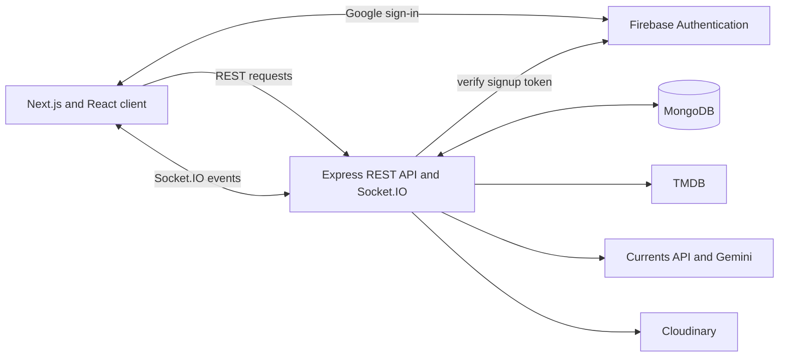

# Nexus

Nexus is an independent Marvel and Marvel Cinematic Universe (MCU) watch tracker and fan community. It brings title discovery, watch progress, personal rankings, and community features together in one web app.

**Live demo:** [ournexus.space](https://ournexus.space) · **Developer portfolio:** [wakamonoo.site](https://wakamonoo.site)

Nexus is an unofficial fan project and is not affiliated with Marvel.

## Features

- **Explore Marvel titles:** Browse chronological and release orders, popular and community GOAT rankings, the visual timeline, latest and upcoming titles, and legacy or Marvel-adjacent collections.
- **Track and share a watch journey:** Mark titles watched, view progress on a profile, and export a chronological, release-order, or cinematic-continuum checklist as a PNG.
- **Build a community profile:** Publish posts and moments, write reviews, create and reorder title lists, comment, react, and earn activity-based sigils.
- **Live community updates:** Socket.IO events deliver chat messages, activity updates, and user notifications.
- **Rina news and recaps:** Gemini generates a Marvel news report from Currents articles and recaps based on recent watched titles.
- **Google sign-in and media uploads:** Firebase Authentication handles Google sign-in; the server uses Cloudinary for profile and community media uploads.

## Engineering highlights

- Split the application into a Next.js App Router client and an Express API, with separate `client` and `server` packages.
- Kept feature-specific UI state in React context providers and grouped backend endpoints into route modules backed by MongoDB.
- Integrated TMDB on the server for title search and details, keeping its access token out of browser requests.
- Used Socket.IO alongside the Express HTTP server for live chat, activity, and notification events.
- Scheduled hourly news refreshes and title-status updates with `node-cron`.
- Built drag-and-drop ranking and list-order interfaces with `@dnd-kit`; generated shareable portfolio cards from rendered UI with `modern-screenshot`.

## Technology

| Technology | Role in Nexus |
| --- | --- |
| Next.js 16, React 19 | App Router pages, layouts, and interactive client UI |
| Tailwind CSS 4, daisyUI | Styling and interface components |
| Node.js, Express 5 | REST API and application services |
| MongoDB Node.js driver | Persistent users, titles, watch progress, posts, reviews, lists, and activity |
| Firebase Authentication, Firebase Admin | Google sign-in and signup-token verification |
| Socket.IO | Real-time chat, activity, and notification events |
| TMDB | Marvel title search and metadata |
| Currents API, Google Gemini | News articles and generated news/watch-history recaps |
| Cloudinary | User and community media uploads |
| `@dnd-kit`, `modern-screenshot` | Reordering and PNG portfolio exports |

## Architecture



The client lives in `client/src/app`, with shared components and context providers under `client/src/components` and `client/src/context`. The server entry point is `server/server.js`; API routes, integrations, and scheduled jobs are organized under `server/routes`, `server/services`, and `server/cron`.

## Run locally

You need Node.js, a MongoDB database, and credentials for the external services used by the features you want to run. Install dependencies in both packages:

```bash
cd server
npm ci
```

```bash
cd client
npm ci
```

Create `server/.env` and `client/.env.local` with the variable names below. Keep credential values out of source control.

**Server variables**

```text
PORT
MONGODB_URI
MONGODB
FIREBASE_PROJECT_ID
FIREBASE_CLIENT_EMAIL
FIREBASE_PRIVATE_KEY
CLOUD_NAME
CLOUDINARY_API_KEY
CLOUDINARY_API_SECRET
TMDB_ACCESS_TOKEN
CURRENTS_API_KEY
GEMINI_API_KEY
```

`PORT` defaults to `4000`; `MONGODB` is the database name. The Firebase Admin private key must be provided in the newline-escaped format expected by the server configuration.

**Client variables**

```text
NEXT_PUBLIC_APP_ENV
NEXT_PUBLIC_FIREBASE_API_KEY
NEXT_PUBLIC_FIREBASE_AUTH_DOMAIN
NEXT_PUBLIC_FIREBASE_PROJECT_ID
NEXT_PUBLIC_FIREBASE_STORAGE_BUCKET
NEXT_PUBLIC_FIREBASE_SENDER_ID
NEXT_PUBLIC_FIREBASE_APP_ID
NEXT_PUBLIC_FIREBASE_MEASUREMENT_ID
```

Set `NEXT_PUBLIC_APP_ENV` to a value other than `production` or `staging` for local development; the client then uses `http://localhost:4000` for the API. Optional client integrations use `NEXT_PUBLIC_EMAILJS_PUBLIC_KEY`, `NEXT_PUBLIC_EMAILJS_SERVICE_ID`, `NEXT_PUBLIC_EMAILJS_TEMPLATE_ID`, `NEXT_PUBLIC_KLIPY_KEY`, and `NEXT_PUBLIC_PAYPAL_ID`.

Start the API and client in separate terminals:

```bash
cd server
npm run dev
```

```bash
cd client
npm run dev
```

The client also provides `npm run build` and `npm run lint`. No automated test script is currently defined in either package.

## Known limitations

- Rina's Gemini service error branches reference an Express response object that is not available in the service functions. Provider failures, and recaps requested without watched titles, can therefore surface as API errors or failed scheduled refreshes.
- The Firebase client code reads `NEXT_PUBLIC_FIREBASE_SENDER_ID`; the local environment files currently use `NEXT_PUBLIC_FIREBASE_MESSAGING_SENDER_ID`. Use the name read by the code when configuring local sign-in.
- News, metadata, authentication, and uploads depend on their external services and corresponding credentials.
